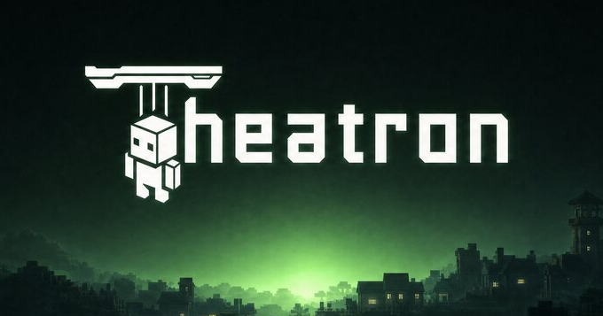

  

<h1 align="center">Make the world in your head playable.</h1>

  <strong>One visual workspace for your Minecraft server.</strong> 
  Build characters, quests, shops, economies, and rules in your browser. Publish them to the game without writing Java.

  

  <a href="https://www.theatronmc.com/">Explore Theatron</a> ·
  <a href="https://app.theatronmc.com/register">Start free</a> ·
  <a href="https://www.theatronmc.com/en/getting-started">How it works</a>

---

## One panel, instead of twenty plugins

1. **Create your world.** Place NPCs on a map, write their dialogue, and build quests, items, shops, and rules in the same workspace.
2. **Connect the pieces.** Use visual Flows to decide what happens when players explore, interact, or complete an objective.
3. **Publish to your server.** What you build in the browser appears in game. Your published world keeps running on your server.

  
   <em>The world map inside the Theatron panel.</em>

<table>
  <tr>
    <td width="50%"></td>
    <td width="50%"></td>
  </tr>
  <tr>
    <td><strong>Characters with purpose.</strong> Give your world people to meet and stories to follow.</td>
    <td><strong>Rules you can see.</strong> Connect events and mechanics without assembling a plugin stack.</td>
  </tr>
</table>

## See it happen

A short clip from the live site shows a catalogue NPC going from the panel into a Paper server. Select the image to play the video.

  

## The open-source path

Theatron is already a working hosted product. We are preparing its open-source release; the product code, license and self-hosting instructions are **not public yet**. The product repositories currently contain scope documentation, and the docs repository contains a Starlight starter. There is no installable release:

| Repository | Planned role |
| --- | --- |
| [theatron](https://github.com/theatronmc/theatron) | Core engine, panel, Paper plugin and self-host stack |
| [launcher](https://github.com/theatronmc/launcher) | Desktop companion for local servers |
| [relay](https://github.com/theatronmc/relay) | Optional Rust multiplayer address service; source release pending |
| [extension-template](https://github.com/theatronmc/extension-template) | Starter for independent extensions |
| [extension-registry](https://github.com/theatronmc/extension-registry) | Reviewed community extension index |
| [docs](https://github.com/theatronmc/docs) | Astro Starlight documentation site; release and installation guides are pending |

Theatron grew out of the [Apeyron Games](https://apeyron.games) community and is built by [Apeyron](https://apeyron.it).

**[Explore the product](https://www.theatronmc.com/)** · **[See all features](https://www.theatronmc.com/en/features)** · **[Read our story](https://www.theatronmc.com/en/about)**
